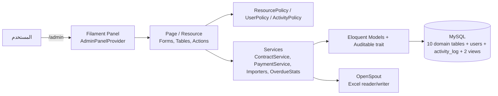

# التوثيق التقني — نظام المتأخرات (Taqneen Lates)

> **الغرض من المستند:** مرجع تقني شامل للمطورين والمديرين: المعمارية، نموذج البيانات، قواعد العمل، مسارات الاستيراد، الصلاحيات، الواجهات، الاختبارات، والنشر.
> **آخر تحديث:** 2026-11-18 — مبني على الملفات الموجودة في المستودع بتاريخه الحالي (بما فيه التعديلات غير الملتزمة على بعض ملفات Filament).
> **وثائق ذات صلة:** [قائمة التشغيل الفعلي](production-checklist.md).

---

## فهرس

1. [نظرة عامة](#1-نظرة-عامة)
2. [حزمة التقنيات والمتطلبات](#2-حزمة-التقنيات-والمتطلبات)
3. [التثبيت والتشغيل المحلي](#3-التثبيت-والتشغيل-المحلي)
4. [المعمارية وخريطة المشروع](#4-المعمارية-وخريطة-المشروع)
5. [نموذج البيانات](#5-نموذج-البيانات)
6. [قواعد العمل الأساسية](#6-قواعد-العمل-الأساسية)
7. [الاستيراد والتصدير (Excel)](#7-الاستيراد-والتصدير-excel)
8. [الصلاحيات والأدوار](#8-الصلاحيات-والأدوار)
9. [الواجهات (Filament UI)](#9-الواجهات-filament-ui)
10. [أوامر Artisan والسكربتات والعمليات](#10-أوامر-artisan-والسكربتات-والعمليات)
11. [سجل العمليات والتدقيق](#11-سجل-العمليات-والتدقيق)
12. [الاختبارات](#12-الاختبارات)
13. [النشر والإنتاج](#13-النشر-والإنتاج)
14. [ملاحظات ومخاطر معروفة](#14-ملاحظات-ومخاطر-معروفة)
15. [ملحق: دليل الملفات الرئيسية](#15-ملحق-دليل-الملفات-الرئيسية)

---

## 1. نظرة عامة

نظام ويب عربي (RTL) لإدارة **عقود تقنين الأراضي وأقساطها** وتتبّع **المتأخرات**. يدير النظام:

- المراكز (المركز/القرية)، المواطنين وأرقام هواتفهم، النواب (الوكلاء) عن المواطن.
- العقود، خطط السداد (كاش / 3 / 5 / 7 سنوات)، الدفعة المقدمة، الأقساط، وعمليات السداد.
- قوائم المتأخرات والأقساط القادمة مبنية على **جداول عرض (views) في MySQL** تُقرأ عبر نماذج Eloquent للقراءة فقط.
- لوحة مؤشرات وتقارير قابلة للتصفية حسب الفترة والمركز وخطة السداد، مع طباعة.
- استيراد دفعات من ملفات Excel الرسمية مع وضع «تحقق فقط» (dry-run) وتقارير أخطاء/تنبيهات.
- سجل عمليات (audit log) لكل تعديل مع اسم المستخدم والقيم القديمة/الجديدة.

### المستخدمون حسب الدور

| الدور | الصلاحية المختصرة |
|---|---|
| مشرف عام (`super_admin`) | كل شيء: إنشاء/تعديل/حذف، إدارة المستخدمين، سجل العمليات، إلغاء السداد |
| مسئول تقنين (`regulator`) | عرض + تصدير + إنشاء/تعديل (بما فيها الاستيراد والسداد)، بدون حذف وإدارة مستخدمين |
| قيادة (`leadership`) | عرض وتصدير فقط (الافتراضي الأقل صلاحية) |

### حدود النظام (Non-goals)

- لا يوجد تطبيق عميل/API عام; كل الوصول عبر لوحة Filament على المسار `/admin`.
- لا يوجد جدولة داخلية (Scheduler) ولا طوابير (Queues) مستخدمة فعلياً رغم تجهيز إعداداتها.
- لا يوجد دعم SQLite: الـ migrations تعتمد صراحة على MySQL (`MODIFY ... ENUM`، `DATEDIFF`، `GROUP_CONCAT`، `CURDATE`).

---

## 2. حزمة التقنيات والمتطلبات

| المكوّن | الإصدار / الإعداد | المصدر |
|---|---|---|
| PHP | `^8.2` | `composer.json:9` |
| Laravel | `^12.0` | `composer.json:11` |
| Filament | `~5.0` (المُثبَّت 5.11.0) | `composer.json:10` |
| Spatie laravel-activitylog | `^5.1` | `composer.json:13` |
| OpenSpout | 4.32.0 (تابع لـ `filament/actions`، غير مذكور مباشرة في `composer.json`) | `composer.lock` |
| MySQL | مطلوب — `utf8mb4` / `utf8mb4_unicode_ci` مع `strict => true` | `config/database.php:47-60` |
| Vite 7 + Tailwind 4 | واجهات/أصول الواجهة | `package.json` |
| PHPUnit | `^11.5` | `composer.json:22` |

### إضافات PHP المطلوبة

`zip`, `xmlreader`, `dom`, `mbstring`, `fileinfo` — لازم تتأكد منها قبل تشغيل الاستيراد/التصدير:

```bash
php -m
```

`storage/app/private` و `storage/framework/*` لازم يكونوا قابلين للكتابة من مستخدم PHP/IIS. تفاصيل إضافية في [قائمة التشغيل الفعلي](production-checklist.md#1-إعدادات-env).

---

## 3. التثبيت والتشغيل المحلي

### 3.1 الخطوات

```bash
composer install
cp .env.example .env          # أو copy على Windows
php artisan key:generate
# عدّل .env: DB_CONNECTION=mysql, DB_DATABASE=taqneen_lates, APP_LOCALE=ar, APP_FALLBACK_LOCALE=ar
mysql -u root -e "CREATE DATABASE taqneen_lates CHARACTER SET utf8mb4 COLLATE utf8mb4_unicode_ci"
php artisan migrate --seed
npm install && npm run build
php artisan serve
```

أو بالاختصار الموجود في `composer.json` (بعد ضبط `.env` وإنشاء قاعدة البيانات):

```bash
composer setup
composer dev     # serve + queue:listen + pail + vite
```

> **تنبيه:** `.env.example` يبدأ بـ `DB_CONNECTION=sqlite` و `APP_LOCALE=en` و `APP_NAME=Laravel`. النظام **لا يعمل على SQLite**؛ لازم تحوّل الإعدادات إلى MySQL والعربية قبل الـ migrate. النسخة المحلية الحالية تستخدم `taqneen_lates` و `APP_LOCALE=ar`.

### 3.2 حساب المدير الافتراضي

يزرعه `AdminUserSeeder` (`database/seeders/AdminUserSeeder.php`):

| البريد | كلمة المرور | الاسم | الدور |
|---|---|---|---|
| `admin@taqneen.test` | `Admin@12345` | مدير النظام | `super_admin` |

**يجب تغيير كلمة المرور فور أول دخول.** خطط السداد تُزرع بواسطة `PaymentPlanSeeder`: كاش (0 أقساط)، ثلاث سنوات، خمس سنوات، سبع سنوات.

### 3.3 قاعدة بيانات الاختبار

`phpunit.xml` يثبّت `DB_CONNECTION=mysql` و `DB_DATABASE=arrears_test` (ويَرِث `DB_USERNAME/DB_PASSWORD` من `.env`). أنشئها يدوياً:

```bash
mysql -u root -e "CREATE DATABASE arrears_test CHARACTER SET utf8mb4 COLLATE utf8mb4_unicode_ci"
php artisan test
```

---

## 4. المعمارية وخريطة المشروع

### 4.1 تدفّق الطلب



### 4.2 خريطة المجلدات

| المسار | المحتوى |
|---|---|
| `app/Models` | نماذج النطاق + نموذجان للقراءة فقط فوق views (`OverdueInstallment`, `UpcomingInstallment`) + trait `Concerns/Auditable` |
| `app/Enums/UserRole.php` | الأدوار الثلاثة ومنطق الصلاحيات |
| `app/Services` | منطق الأعمال: إنشاء العقود، السداد/الإلغاء، المستوردان، إحصاءات المتأخرات، كائنات النتائج |
| `app/Services/Excel` | قراءة/كتابة XLSX بـ OpenSpout، فحص الملف، القالب، التقارير، مجلد temp |
| `app/Filament` | `Resources` (النماذج/الجداول/الصفحات/علاقات)، `Pages` (Dashboard, Reports, AddInstallments), `Widgets` |
| `app/Policies` | `ResourcePolicy`, `UserPolicy`, `ActivityPolicy` |
| `app/Providers` | `AppServiceProvider` (تسجيل السياسات)، `Filament/AdminPanelProvider` (إعداد اللوحة) |
| `app/Support` | `OverdueFilters`, `OverdueStatsSql`, `ActivityChanges`, `Theme/KfsTheme` |
| `app/Console/Commands` | `arrears:import`, `arrears:template` |
| `database/migrations` | 19 migration (10 جداول نطاق + جداول الإطار + 2 views + تعديلات لاحقة) |
| `database/seeders` | `DatabaseSeeder`, `AdminUserSeeder`, `PaymentPlanSeeder`, `DemoOverdueSeeder` (اختياري) |
| `docs` | `production-checklist.md` وهذا المستند |
| `resources/views/filament` | صفحة «إضافة أقساط» وولاencia طباعة التقرير |
| `scripts/backup-database.bat` | نسخة احتياطية يومية لـ MySQL على Windows |
| `tests/Feature`, `tests/Unit` | 11 ملف اختبار / 95 حالة اختبار |

لا يوجد `app/Http/Controllers` فعلي (ملف قاعدة فارغ فقط)، ولا routes مخصصة: `routes/web.php` يحتوي فقط على صفحة Laravel الترحيبية، و`routes/console.php` على أمر `inspire`. كل مسارات التطبيق مسجّلة تلقائياً بواسطة Filament.

---

## 5. نموذج البيانات

### 5.1 مخطط العلاقات

```mermaid
erDiagram
    CENTER ||--o{ CITIZEN : "center_id (SET NULL)"
    CITIZEN ||--o{ CITIZEN_PHONE : "citizen_id (CASCADE)"
    CITIZEN ||--o{ REPRESENTATIVE : "citizen_id (CASCADE)"
    CITIZEN ||--o{ CONTRACT : "citizen_id (CASCADE)"
    REPRESENTATIVE ||--o{ REPRESENTATIVE_PHONE : "representative_id (CASCADE)"
    PAYMENT_PLAN ||--o{ CONTRACT : "payment_plan_id"
    CONTRACT ||--o{ INSTALLMENT : "contract_id (CASCADE)"
    CONTRACT ||--o{ PAYMENT : "contract_id (CASCADE)"
    INSTALLMENT ||--o{ INSTALLMENT_NOTE : "installment_id (CASCADE)"
    INSTALLMENT ||--o{ PAYMENT : "installment_id (SET NULL)"
    USER ||--o{ CITIZEN : "created_by / updated_by (SET NULL)"
    USER ||--o{ CONTRACT : "created_by / updated_by (SET NULL)"
    USER ||--o{ INSTALLMENT : "created_by / updated_by (SET NULL)"
    USER ||--o{ PAYMENT : "created_by (SET NULL)"
    USER ||--o{ INSTALLMENT_NOTE : "user_id (SET NULL)"

    CENTER { bigint id PK }
    CITIZEN { bigint id PK, string national_id UK }
    CONTRACT { bigint id PK, string code UK, bigint citizen_id FK }
    INSTALLMENT { bigint id PK, tinyint installment_no, date due_date, enum status }
    PAYMENT { bigint id PK, enum type, date paid_at }
    PAYMENT_PLAN { bigint id PK, tinyint installments_count, bool is_cash }
```

### 5.2 جداول النطاق

كل الجداول التالية تحتوي `created_at` / `updated_at` ما لم يُذكر غير ذلك، ومعرف `id` من نوع `bigint unsigned` تلقائي.

| الجدول | الأعمدة الرئيسية | القيود والفهارس |
|---|---|---|
| `centers` | `name`, `governorate?` | `name` فريد |
| `payment_plans` | `name`, `installments_count` (افتراضي 0 = كاش), `is_cash`, `is_completed` | `name` فريد; `is_completed` أُضيف في migration لاحقة |
| `citizens` | `name`, `national_id?` (14 رقماً), `center_id?`, `address?`, `created_by?`, `updated_by?` | `national_id` فريد، فهرس على `name`، FK: `centers` SET NULL، `users` SET NULL. **عمود `code` قديم نُقل إلى `contracts`** |
| `citizen_phones` | `citizen_id`, `phone`, `label?`, `is_primary` | FK CASCADE، فهرس على `phone` |
| `representatives` | `citizen_id`, `name`, `relationship?`, `started_at?`, `ended_at?` | FK CASCADE، فهرس مركّب `(citizen_id, ended_at)`؛ الحالي = `ended_at IS NULL` |
| `representative_phones` | `representative_id`, `phone`, `label?`, `is_primary` | FK CASCADE، فهرس على `phone` |
| `contracts` | `code` ( varchar(50) ), `citizen_id`, `payment_plan_id`, `serial_no?`, `down_payment_amount` (decimal 14,2), `down_payment_date?`, `interest_amount`, `total_price`, `created_by?`, `updated_by?` | `code` فريد/not null، فهرس مركّب `(citizen_id, payment_plan_id)`، FK: citizens CASCADE، users SET NULL |
| `installments` | `contract_id`, `installment_no` (1..7), `due_date?`, `permit_date?`, `amount`, `paid_amount` (افتراضي 0), `paid_at?`, `status` ENUM(`pending`,`paid`) | فريد `(contract_id, installment_no)`، فهرس `(status, due_date)`، FK: contracts CASCADE، users SET NULL. `due_date` أصبح nullable؛ حُذفت أعمدة الترحيل `carried_in/out` |
| `installment_notes` | `installment_id`, `user_id?`, `note` | FK CASCADE / SET NULL |
| `payments` | `contract_id`, `installment_id?`, `type` ENUM(`down_payment`,`installment`,`cash`), `amount`, `paid_at`, `receipt_no?`, `created_by?` | فهرس على `paid_at`، FK: contracts CASCADE، installments SET NULL، users SET NULL |
| `users` | `name`, `email` (فريد), `password`, `role` (افتراضي `leadership`), `is_active` (افتراضي true) | جداول الإطار: `password_reset_tokens`, `sessions`, `cache`, `cache_locks`, `jobs`, `job_batches`, `failed_jobs` |
| `activity_log` | `log_name?`, `description`, `subject_*`, `event?`, `attribute_changes` JSON, `properties` JSON, `causer_*` | فهارس على `log_name` و morphs؛ جدول خاص بـ Spatie v5 (بدون `from`/`to`)، migration الخاص به **بدون `down()`** |

### 5.3 Views (للقراءة فقط)

#### `overdue_installments` — المتأخرات

التعريف النهائي في `database/migrations/2026_10_29_300000_move_code_to_contracts_table.php:74-114` (بُني أولاً في `...000008` ثم أُعيد بناؤه مرتين):

- **الشرط:** `i.status = 'pending' AND i.due_date < CURDATE()` — لا فترة سماح (متأخر من يوم واحد).
- **الأعمدة:** `installment_id`, `contract_id`, `contract_code`, `serial_no`, `payment_plan_id`, `payment_plan_name`, `citizen_id`, `citizen_name`, `center_id`, `center_name`, `citizen_phones`, `representative_name`, `representative_relationship`, `representative_phones`, `installment_no`, `due_date`, `days_overdue`, `amount`, `paid_amount`, `remaining_amount`.
- **الحساب:** `days_overdue = DATEDIFF(CURDATE(), due_date)`, `remaining_amount = amount - paid_amount`.
- النائب يُربط بشرط `ended_at IS NULL`، والهواتف تُجمَع بـ `GROUP_CONCAT(... SEPARATOR ' - ')`.

#### `upcoming_installments` — الأقساط القادمة

التعريف في `database/migrations/2026_11_17_112219_create_upcoming_installments_view.php`:

- **الشرط:** `pending AND due_date BETWEEN CURDATE() AND DATE_ADD(CURDATE(), INTERVAL 30 DAY)` (أفق ثابت 30 يوماً).
- **الأعمدة:** نفس مجموعة المتأخرات مع `days_remaining = DATEDIFF(due_date, CURDATE())` بدل `days_overdue`، وبدون `days_overdue`.

لكل من الـ view نموذج Eloquent يمنع الكتابة (`save()` / `delete()` يرميان `LogicException`)، ولا يستخدم `Auditable`.

### 5.4 ترتيب الـ migrations وتأثيرها

| Migration | الأثر |
|---|---|
| `0001_01_01_000000/1/2` | جداول المستخدمين/الكاش/الطوابير (Laravel افتراضي) |
| `2026_10_29_000001..000007` | إنشاء جداول النطاق + view المتأخرات الأولي |
| `2026_10_29_100000` | إضافة `role` و `is_active` إلى `users` |
| `2026_10_29_200000` | إلغاء أعمدة الترحيل وتضييق `status` إلى `pending|paid` وإعادة بناء الـ view |
| `2026_10_29_202154` | إنشاء جدول `activity_log` (Spatie v5) |
| `2026_10_29_300000` | نقل `code` من `citizens` إلى `contracts` (تعبئة + تفريد + إعادة بناء الـ view) |
| `2026_10_30_100000` | جعل `due_date` nullable |
| `2026_11_10_094152` | إضافة `is_completed` إلى `payment_plans` |
| `2026_11_16_000000` | إضافة `permit_date` إلى `installments` |
| `2026_11_17_112219` | إنشاء view الأقساط القادمة |

---

## 6. قواعد العمل الأساسية

### 6.1 مواعيد الاستحقاق

- القسط رقم `N` يستحق بعد `N` سنوات من **تاريخ المقدم**، باستخدام `addYearsNoOverflow()`؛ أي أن `2024-02-29 + 1 سنة = 2025-02-28` (ليس مارس).
- غياب تاريخ المقدم ⇒ تُخزَّن كل الأقساط بـ `due_date = null` مع تنبيه؛ هذه الأقساط **لا تظهر** في المتأخرات ولا في القادمة حتى يُضاف لها موعد.
- `ContractService::fillMissingDueDates()` يملأ المواعيد الناقصة من تاريخ المقدم دون لمس التواريخ الموجودة (يُستدعى بعد تعديل العقد، ويمكن تنفيذه من علاقة الأقساط).
- تعديل تاريخ قسط مسدّد ممنوع (استثناء: ملء موعد كان `null` مسموح).

### 6.2 السداد والمتأخرات

- **لا سداد جزئي:** `InstallmentPaymentService::pay()` ينشئ `Payment` بقيمة `installment.amount` كاملة، ويضبط `paid_amount`, `paid_at`, `status = paid` داخل transaction مع `lockForUpdate()` لمنع السداد المزدوج المتزامن.
- تاريخ سداد في المستقبل مرفوض.
- المتأخر = قسط `pending` وتاريخ استحقاقه **أقل** من اليوم الحالي (بدون فترة سماح)؛ القسط المستحق اليوم ليس متأخراً.
- فئات العمر (للرسم البياني): 1–30، 31–90، 91–180، 181–365، 366+ يوماً.
- `upcoming` = قسط `pending` خلال 30 يوماً من اليوم (شامل اليوم).
- **إلغاء السداد** (`void()`): يحذف مدفوعات نوع `installment` (عبر `each->delete()` حتى تُسجَّل في الـ audit log)، ويعيد القسط إلى `pending` مع `paid_amount = 0`. متاح في الواجهة لمشرف عام فقط.
- أنواع المدفوعات: `down_payment`, `installment`, `cash`.

### 6.3 العقود والكود

- `contracts.code` فريد (varchar 50) ويُؤخذ من عمود «كود» في الإكسيل؛ لا يُولَّد آلياً. `serial_no` يُؤخذ من عمود «م».
- `total_price` يجب أن يساوي `down_payment_amount + Σ installments.amount` (يتحقق النظام بالسنتات لتجنب أخطاء الفاصلة)؛ وإذا كان الفرق في الإكسيل > 0.5 يُصدر تنبيهاً ويُحفظ المبلغ المحسوب.
- خطة الكاش: دفعة واحدة من نوع `cash`، بدون أقساط، و`total_price = المبلغ المدفوع`.
- عقد «تم سداد كامل ثمن الأرض» (`completed`): تحديد نوعه من عدد الأقساط المكتوبة (3/5/7)؛ أقساط بلا تاريخ سداد تُسجَّل مسدّدة دون `Payment` مع تنبيه.

### 6.4 النائب والمواطن

- المواطن يُطابق أولاً برقمه القومي، وإلا بالاسم + المركز. أكثر من تطابق ⇒ إنشاء مواطن جديد مع تنبيه.
- **نائب حالي واحد فقط لكل مواطن:** عند إنشاء نائب جديد بـ `ended_at = null`، يُغلق `Representative::created` كل النواب الحاليين الآخرين بتاريخ اليوم (يُسجَّل في الـ audit log).
- أرقام الهاتف: تُفصل بـ `, ، ; ؛ / |` أو سطر جديد، تُصحَّح أرقام الـ 10 الخانات التي تبدأ بـ `1` بإضافة صفر، وتُرفض الأطوال خارج 7–15 مع تنبيه، ثم يُزال التكرار والأول هو الأساسي.

### 6.5 الإحصاءات والتصفية

- `OverdueStatsSql` يبني استعلامات SQL على الـ view مع `ONLY_FULL_GROUP_BY`-compatible، ويمرّر كل القيم كـ bindings عبر `OverdueFilters` (تحقق من التاريخ بـ `checkdate`، وتجاهل `center_id` غير الرقمي، وعكس الفترة المقلوبة تلقائياً).
- إذا اختلف توقيت MySQL عن توقيت القاهرة، قد تظهر الأقساط متأخرة قبل/بعد موعدها بيوم — راجع [قسم النشر](#13-النشر-والإنتاج).

---

## 7. الاستيراد والتصدير (Excel)

كل التعامل مع Excel عبر **OpenSpout** مباشرة (لا maatwebsite/excel ولا PhpSpreadsheet). يُقبل ** XLSX فقط**؛ يرفض `ExcelFileGuard` ملفات `.xls` القديمة (OLE2) والمشفّرة برسائل عربية واضحة. الملفات تُقرأ كاملة في الذاكرة (لا حد عدد صفوف، وحد الحجم 10 MB في الواجهة).

### 7.1 مسار A — استيراد العقود والأقساط (`ArrearsImporter`)

**الدخول:** زر «استيراد Excel» في قائمة العقود (لمن يملك `create Contract`) أو الأمر `arrears:import`.

**الملف:** يُقرأ الشيت **الأول فقط** (أي اسم)، والصف الأول هو الهيدر. يُنشأ القالب من زر «تحميل القالب» أو الأمر `arrears:template`، ويحتوي شيتَي `البيانات` و`تعليمات` باتجاه RTL.

**الأعمدة (ترتيب القالب في `ArrearsTemplateWriter::HEADERS`):**

```
(ترقيم بدون عنوان) | نوع القسط | م | كود | الاسم | المركز
| مبلغ الدفعة المقدمة | اجمالى الثمن بالفايدة | تاريخ المقدم
| القسط الاول | تاريخ السداد | ... | القسط السابع | تاريخ السداد
| ملاحظات | الرقم القومي | هاتف المواطن | اسم النائب | صلة القرابة | هاتف النائب | الفائدة
```

- **إلزامي:** `نوع القسط`, `كود`, `الاسم`، وعمود قسط واحد على الأقل بعنوان `القسط الأول..السابع` يليه مباشرة عمود `تاريخ السداد`.
- **تحسينات التحليل:** توحيد الألف/الهمزات (`أ إ آ → ا`, `ى → ي`, `ة → ه`)، إزالة التطويل، تحويل الأرقام العربية/الفارسية، وقبول التواريخ كأرقام Excel (المرجع 1899-12-30) أو `Y/m/d` / `d/m/Y`؛ التاريخ المستحيل يُقصّ إلى آخر الشهر مع تنبيه.
- **أنواع السداد:** `سداد 100% / كاش / نقد / 100%` ⇒ كاش؛ `ثلاث/تلات/3`, `خمس/5`, `سبع/7` ⇒ خطة سنوات؛ `تم سداد كامل ثمن الأرض/كامل + سداد` ⇒ `completed`; أي شيء آخر ⇒ خطأ صف.

**قواعد الصف:**

| الحالة | النتيجة |
|---|---|
| كود مكرر في النظام | الصف يتخطى بخطأ «الكود موجود بالفعل في النظام» |
| كاش مع أعمدة أقساط / مقدم غير موجب | خطأ صف |
| خطة سنوات بنقص قسط أو قسط ≤ 0 أو عدد غير مطابق | خطأ صف وrollback للصف |
| تاريخ مقدم ناقص | التنبيه + أقساط بلا موعد (لا تظهر في المتأخرات) |
| الرقم القومي/الهاتف غير صالح، «م» أو فائدة غير رقمية، تاريخ غير مفهوم | تنبيه فقط ويُجاهل الحقل |
| فرق إجمالي الإكسيل عن المحسوب > 0.5 | تنبيه ويُحفظ المحسوب |
| تغيّر النائب | إغلاق النائب القديم بتاريخ اليوم + تنبيه |
| ملاحظات الصف | تُضاف كـ `InstallmentNote` على أول قسط غير مسدّد (أو الأخير) |

**المعاملات (transactions):** التحليل أولاً، ثم كل صف داخل `DB::transaction()` مستقل. في وضع **«تحقق فقط»** تُفتح معاملة خارجية واحدة تُلغى في `finally` — لا يُحفظ أي شيء (بما فيه سجل العمليات والمدفوعات). الأخطاء لا توقف الصفوف الأخرى.

**النتيجة والتقرير:** كائن `ImportResult` يحسب `total/contracts/citizensCreated/citizensReused/paidInstallments/errors/warnings` و`summary()` (تبدأ بـ `[تحقق فقط - ماتحفظش حاجة]`). في الواجهة: إشعار بأول 5 أخطاء و5 تنبيهات وتنزيل تلقائي لتقرير XLSX؛ في CLI: جدول بأول 50 خطأ وملف `<اسم_الملف>_errors.xlsx` بجوار الملف.

### 7.2 مسار B — إضافة أقساط/سداد من تقرير الرسوم (`InstallmentAdditionImporter`)

**الدخول:** صفحة مستقلة «إضافة أقساط» `/admin/add-installments` (تتطلب `create Contract`)؛ **لا يوجد أمر Artisan لها**.

**الملف:** الشيت الأول، **الهيدر في الصف 9 والبيانات تبدأ من الصف 10** (إلا رُفض الملف بـ `ImportFormatException`). الأعمدة المعترف بها: `رقم الطلب`, `تاريخ الإصدار`, `المبلغ`, `تاريخ الأذن`, `الاسم`, `التليفون/الهاتف`, `الرقم القومي`, `م`.

- إلزامي: `رقم الطلب` **أو** (`الاسم` + `التليفون`)، و`المبلغ` **أو** `تاريخ الأذن`.
- كود العقد يُشتق من `رقم الطلب` بأخذ الجزء قبل `/` أو `\` (مثال `201148/32 → 201148`).
- تواريخ الإصدار/الأذن في المستقبل مرفوضة؛ المبلغ يجب أن يكون رقمياً وموجباً.
- **ترتيب المطابقة:** كود العقد exact → رقم قومي → اسم+هاتف exact → اسم `LIKE` + هاتف. عند تعدد العقود يُختار ما عليه متأخر، وإلا الأقل `id` مع تنبيه.
- **اختيار القسط:** أقرب `due_date` لتاريخ الإصدار؛ إن لم توجد مواعيد يُؤخذ الأول مع تنبيه؛ بدون تاريخ إصدار يُؤخذ أول قسط غير مسدّد متأخر وإلا أول غير مسدّد.
- **تاريخ الأذن فقط** (بدون إصدار): يُحفظ `permit_date` ويُسجَّل حدث `installment_permit` بدون `Payment`.
- **تاريخ الإصدار:** المبلغ في التقرير **يستبدل** `installment.amount` ويُضاف الفرق إلى `total_price`، ثم يتم السداد الكامل عبر `InstallmentPaymentService` وتُسجَّل عملية `installment_payment`. أذن قبل الاستحقاق تنبيه فقط.
- **إعادة تشغيل نفس الملف آمنة:** القسط يظهر مسدّداً فيُتخطى مع تنبيه. وضع dry-run يُلغى بالكامل (صفر مدفوعات وصفر سجلات audit).

النتيجة في `InstallmentAdditionResult`: `applied/skipped/paidInstallments/permitsSaved/paidTotal/errors/warnings`. الواجهة تعرض حتى 50 خطأً و50 تنبيهاً وتتيح تنزيل تقرير XLSX (`أخطاء (اتتخطت)` + `تنبيهات (اتقبلت)`).

### 7.3 التصدير

| المخرج | المكان | الوصف |
|---|---|---|
| قالب الاستيراد | زر «تحميل القالب» / `arrears:template` | `arrears-import-template.xlsx`، شيتا `البيانات` و`تعليمات` |
| المتأخرات | زر «تصدير Excel» في قائمة المتأخرات | بث مباشر إلى `php://output` باسم `overdue-Y-m-d_H-i.xlsx`، يحترم التبويبات/الفلاتر/البحث/الترتيب الحالية (`getFilteredSortedTableQuery()`) |
| تقرير أخطاء الاستيراد | تلقائي/CLI | XLSX بأعمدة `رقم الصف`, `الكود`, `السبب` (+ شيت التنبيهات إن وُجد) |
| تقرير إضافة الأقساط | زر «تحميل التقرير» | `installment-additions-report-Y-m-d_H-i.xlsx`، يُحذف بعد الإرسال |
| تقرير مطبوع | زر «طباعة التقرير» في صفحة التقارير | JS يجهّز الجدول ويضيف صف إجمالي واتجاه RTL ثم `window.print()` |

**مجلد temp:** `OpenSpoutTempFolder` يجرب بالترتيب مجلد بجوار الملف، ثم `storage/app/private/openspout-temp`، ثم مسارات `storage` أخرى، وأخيراً `sys_get_temp_dir()`، مع اختبار كتابة فعلي (حل لمشاكل صلاحيات IIS/Windows).

---

## 8. الصلاحيات والأدوار

### 8.1 مصفوفة الصلاحيات

`app/Enums/UserRole.php` يعرّف الحالاتوقيم والواجهات؛ `app/Policies/ResourcePolicy.php` يطبّقها على كل نماذج النطاق:

| الصلاحية | مشرف عام | مسئول تقنين | قيادة | الدالة |
|---|---|---|---|---|
| عرض/تصدير | ✔ | ✔ | ✔ | `canView()`, `canExport()` |
| إنشاء/تعديل | ✔ | ✔ | ✘ | `canCreateOrUpdate()` |
| حذف | ✔ | ✘ | ✘ | `canDelete()` |
| إدارة المستخدمين | ✔ | ✘ | ✘ | `canManageUsers()` |
| سجل العمليات | ✔ (قراءة فقط) | ✘ | ✘ | `ActivityPolicy` |
| إلغاء السداد | ✔ | ✘ | ✘ | `can('delete', Installment)` |

المستخدم غير النشط (`is_active = false`) لا يستطيع دخول اللوحة إطلاقاً (`User::canAccessPanel()`) ويُعامل كأن بلا دور.

### 8.2 التنفيذ

- `AppServiceProvider::register()` يسجّل `ResourcePolicy` لـ 11 نموذجاً (من ضمنها `OverdueInstallment`)، و`UserPolicy` للمستخدمين، و`ActivityPolicy` لسجل العمليات في `boot()`. لا توجد `Gate::define` ولا `getAuthorization...` مخصصة في الـ resources.
- حماية إضافية في الواجهة:
  - «إضافة أقساط» واستيراد العقود/template: `can('create', Contract::class)` + فحص 403 داخل الدوال.
  - تصدير المتأخرات: `can('export', OverdueInstallment::class)`.
  - زر «إلغاء السداد» يظهر فقط إذا كان القسط مسدّداً والمستخدم يملك `deleteInstallment`.
  - المستخدم لا يستطيع تغيير دوره ولا حالة تفعيله بنفسه (حقل معطّل في نموذج المستخدم).
- الموارد للقراءة فقط (`canCreate/canEdit/canDelete` = false): المتأخرات، الأقساط القادمة، سجل العمليات.

---

## 9. الواجهات (Filament UI)

### 9.1 إعداد اللوحة

`app/Providers/Filament/AdminPanelProvider.php`: panel وحيد بالمعرف `admin` على المسار `/admin`، اسم العلامة «نظام المتأخرات»، تسجيل دخول Filament افتراضي، خط Tajawal محلي (`public/css/kfs/fonts.css`)، ألوان `KfsTheme` (أخضر ملكي `#123F35`، نجاح `#237A52`، تحذير `#B27A24`، خطر `#A93232`)، وحقن `public/css/kfs/theme.css` عبر `PanelsRenderHook::STYLES_AFTER`. الاكتشاف التلقائي مفعّل للموارد والصفحات والودجتس؛ لا توجد navigation groups ولا clusters ولا صفحات مصادقة مخصصة.

> ملاحظة: `->darkMode(true)` مفعّل رغم تعليق داخل الكود يقول إن نظام التصميم يدعم الوضع الفاتح فقط — راجع [الملاحظات](#14-ملاحظات-ومخاطر-معروفة).

### 9.2 القائمة والصفحات

| الترتيب | العنصر | المسار النوعي | الوظيفة |
|---|---|---|---|
| 1 | المتأخرات | Resource | جدول قراءة فقط + تبويبات (الكل/3/5/7 سنوات) + تصدير Excel + شارة عدد باللون الأحمر |
| 2 | المواطنون | Resource | CRUD + هواتف (Repeater) + علاقات العقود والنواب |
| 2 | الأقساط القادمة | Resource | جدول قراءة فقط لأقساط 30 يوماً + شارة تحذير |
| 2 | التقارير | Custom Page | جدول متأخرات قابل للتصفية + طباعة |
| 3 | العقود | Resource | CRUD + إدارة الأقساط/المدفوعات/الملاحظات + استيراد/قالب |
| 3 | إضافة أقساط | Custom Page | استيراد تقرير السداد (dry-run افتراضي) |
| 9 | سجل العمليات | Resource | قراءة فقط لمشرف عام، فلاتر وتفاصيل التغييرات |
| — | المستخدمون | Resource | إدارة الحسابات والأدوار |
| — | Dashboard | Page | 5 ودجتس إحصائية مع فلاتر الفترة والمركز |

### 9.3 تفاصيل الموارد

**المواطنون:** نموذج من قسمين (`بيانات المواطن`: الاسم، الرقم القومي بطول 14 وتحقق رقمي/تفرد، المركز مع إمكانية الإنشاء السريع، العنوان؛ `أرقام الهاتف`: Repeater للهاتف/الملاحظة/الأساسي). الجدول يعرض النائب الحالي وعدد العقود، وفلتر بالمركز، وحذف جماعي.

**العقود:** النموذج يربط المواطن (يُعطَّل عند التعديل) وخطة السداد (قابلة للتعديل في شاشة التعديل)، الكود، «م»، المقدم، الأقساط (Repeater يُولَّد تلقائياً بعدد أقساط الخطة المختارة، بدون إضافة/حذف/ترتيب يدوي)، مبلغ الكاش، الفائدة، والإجمالي (محسوب تلقائياً وغير قابل للتعديل يدوياً). تغيير نوع السداد في التعديل يعيد توليد الأقساط غير المسددة فقط: تُحدَّث قيمها ويُضاف ما ينقص ويُحذف الزائد، بينما تبقى الأقساط المسددة كما هي (لا يمكن التحويل لكاش وفيه أقساط مسددة). الإجمالي = المقدم/المبلغ الكاش + الأقساط المسددة + الأقساط المُدخلة. إنشاء العقد يمرّر البيانات إلى `ContractService::create()` لضمان ذرية إنشاء الأقساط والمدفوعات، والتعديل يمرّرها إلى `ContractService::prepareEditTotal()` و`syncInstallmentsForEdit()`. الجدول يعرض المسدّد/المتأخر/البيانات الناقصة مع فلاتر متقدمة (`has_overdue`, `missing_data`)، وأزرار التعديل («فتح»)، والحذف، والاستيراد، وتحميل القالب.

**علاقة الأقساط (في العقد):** سداد القسط (لغير المسدّد ولمن يملك `update`)، ملاحظة جديدة، إلغاء السداد (لمشرف عام)، وملء المواعيد الناقصة من تاريخ المقدم. القسط المسدود لا يمكن تعديل مبلغه/موعده.

**المستخدمون:** الاسم، البريد، الدور (افتراضي `leadership`)، كلمة المرور (8+ أحرف، مطلوبة عند الإنشاء فقط، ولا تُخزَّن في السجل)، وتفعيل الحساب. عرض/تعديل/حذف مع منع حذف النفس.

**سجل العمليات:** يعرض التاريخ، المستخدم، الحدث (إضافة/تعديل/حذف)، نوع الكائن، عنوانه، ونافذة «التفاصيل» تعرض الفروق بالعربية عبر `ActivityChanges::html()` (مع إخفاء كلمات المرور والطوابع الزمنية وهروب HTML).

**صفحة إضافة الأقساط:** Blade خاص بـ تعليمات تنسيق الملف (صف 9/10)، زر «تحقق فقط (من غير حفظ)»، زر «تنفيذ السداد» مع تأكيد، بطاقات النتائج، تنزيل التقرير، وجداول التنبيهات/الأخطاء.

### 9.4 الودجتس والتقارير

| الودجت | النوع | البيانات |
|---|---|---|
| `OverdueStatsOverview` | 4 أرقام | إجمالي المتأخرات، عدد المتأخرين، ما تحصّل هذا الشهر، بيانات ناقصة (روابط للقوائم) |
| `OverdueAgingChart` | أعمدة | المتبقي حسب فئات مدة التأخير |
| `OverduePlanChart` | دائري | عدد الأقساط المتأخرة حسب خطة السداد |
| `OverdueByCenterTable` | جدول | عدد المواطنين/الأقساط والإجمالي والنسبة لكل مركز + رابط فلترة |
| `TopOverdueCitizens` | جدول | أكبر 10 مواطنين متأخرين مع هواتفهم وأقصى مدة تأخير |
| `OverdueReportTable` | جدول | نسخة قابلة للطباعة من جدول المتأخرات بدون أعمدة الهواتف/النائب |

فلاتر الصفحة (`from`, `until`, `center_id` في Dashboard؛ `center_id`, `payment_plan_id` في التقارير) تُحفظ في الجلسة عبر `InteractsWithPageFilters` وتمرّر إلى `OverdueFilters`.

---

## 10. أوامر Artisan والسكربتات والعمليات

### 10.1 الأوامر المخصصة

```bash
# استيراد العقود من قالب النظام
php artisan arrears:import {file} [--dry-run] [--user=ID]

# أمثلة
php artisan arrears:import storage/app/arrears.xlsx --dry-run
php artisan arrears:import storage/app/arrears.xlsx --user=1

# توليد قالب فارغ
php artisan arrears:template [path]        # الافتراضي: storage/app/arrears-import-template.xlsx
```

`arrears:import` يُطبع الملخص وكل التنبيهات وأول 50 خطأً، ويكتب `<basename>_errors.xlsx`. يرجع `FAILURE` فقط عند غياب الملف أو خطأ تنسيق الملف نفسه؛ أخطاء الصفوف لا تُفشل الأمر. لا يوجد Kernel مخصص (Laravel 12 يكتشف الأوامر تلقائياً).

### 10.2 النسخ الاحتياطي

`scripts/backup-database.bat` (Windows/XAMPP):

- `mysqldump -u root --single-transaction --default-character-set=utf8mb4 <DB> > D:\Zaynab\Backups\<DB>_<timestamp>.sql`
- يحذف النسخ الأقدم من 30 يوماً (`forfiles /d -30`).
- **ينتظر ضبط `DB_NAME`** (المكتوب حالياً `arrears` بينما قاعدة العمل `taqneen_lates`) وضبط كلمة المرور إن وُجدت.
- يُنصح بجدولته عبر Windows Task Scheduler، وتجربة الاسترجاع مرة على قاعدة اختبار.

### 10.3 التخزين والملفات المؤقتة

| المسار | الاستخدام |
|---|---|
| `storage/app/private/imports` | رفع ملفات الاستيراد (disk `local`)، وتُحذف بعد المعالجة في `finally` |
| `storage/app/private/openspout-temp` | الملفات الوسيطة لقارئ/كاتب OpenSpout |
| `storage/app/arrears-import-template.xlsx` | مسار القالب الافتراضي للأمر CLI |
| `storage/app/overdue_view.sql` | **أرشيف قديم** لتعريف الـ view لا يطابق الحالي (لا يُستخدم) |

لا توجد jobs ولا `dispatch()`؛ إعداد `QUEUE_CONNECTION=database` وجدولة `queue:listen` في `composer dev` تكون للاستخدام المستقبلي فقط.

---

## 11. سجل العمليات والتدقيق

- الجدول `activity_log` بصيغة Spatie **v5**: `attribute_changes` (JSON) و`properties` (JSON) بدل `from/to` القديمتين.
- trait `Auditable` (`app/Models/Concerns/Auditable.php`) يطبّق `LogsActivity` مع `logAll()->logOnlyDirty()` على 10 نماذج: `Center`, `Citizen`, `CitizenPhone`, `Contract`, `Installment`, `InstallmentNote`, `Payment`, `PaymentPlan`, `Representative`, `RepresentativePhone`.
- `User` يسجّل فقط `name, email, role, is_active` (لا كلمة المرور ولا الـ remember token).
- المستورد الثاني يسجّل أحداثاً يدوية باسم `installment_additions`: `installment_payment`, `installment_permit` مع رقم الصف ورقم الطلب ومعرفات العقد/القسط، و`causedBy($userId)` عند توفره.
- `ActivityChanges` يترجم أسماء الحقول والقيم إلى العربية، ويخفي الحقول التقنية، ويهرب HTML ويقتطع القيم الطويلة إلى 200 حرف.
- العرض عبر `ActivityLogResource` للقراءة فقط مع فلاتر (الحدث، النوع، المستخدم، الفترة) ونافذة تفاصيل.
- **قاعدة مهمة:** تعطيل حساب الموظف بدل حذفه حتى يبقى اسمه في السجل.

---

## 12. الاختبارات

### 12.1 التشغيل

```bash
php artisan test          # أو: composer test (ينفّذ config:clear أولاً)
```

`phpunit.xml`: `APP_ENV=testing`, `DB_CONNECTION=mysql`, `DB_DATABASE=arrears_test`, `CACHE_STORE=array`, `QUEUE_CONNECTION=sync`, `SESSION_DRIVER=array`. معظم اختبارات Feature تستخدم `RefreshDatabase`. ملفات XLSX تُولَّد وقت التشغيل بـ OpenSpout وتُحذف في `tearDown()`.

### 12.2 التغطية (11 ملفاً / 95 حالة)

| الملف | عدد الحالات | ما يغطيه |
|---|---|---|
| `tests/Feature/ArrearsImportTest.php` | 20 | الاستيراد الكامل: كاش، مكتمل، تواريخ، تحذيرات، dry-run، تكرار الكود، نواب وملاحظات، أخطاء التنسيق |
| `tests/Feature/InstallmentAdditionImportTest.php` | 18 | سداد/أذن، تجاوز المبلغ، رفض المستقبل، idempotency، المطابقة البديلة، ملفات تالفة/مشفّرة |
| `tests/Feature/ContractAndPaymentTest.php` | 16 | حساب التواريخ (بما فيها 29 فبراير)، التحقق من المبلغ/العد، السداد الكامل والمركز، الإلغاء، حد المتأخر |
| `tests/Feature/ContractScreensSupportTest.php` | 9 | ملء المواعيد الناقصة، دورة حياة النائب، مزامنة المقدم، الملاحظات |
| `tests/Feature/OverdueStatsTest.php` | 8 | الإجماليات، الفئات العمرية، الترتيب، الفلاتر، الحالات الفارغة |
| `tests/Feature/UpcomingInstallmentsTest.php` | 2 | حدود نافذة 30 يوماً |
| `tests/Feature/AddInstallmentsPageTest.php` | 3 | الوصول حسب الدور واسم المسار |
| `tests/Feature/ExampleTest.php` | 1 | الصفحة الترحيبية |
| `tests/Unit/ActivityChangesTest.php` | 9 | تنسيق الفروق بالعربية وهروب HTML |
| `tests/Unit/OverdueFiltersTest.php` | 8 | البارامترات، الفترات المعكوسة، منع الحقن |
| `tests/Unit/ExampleTest.php` | 1 | اختبار هيكلي |

---

## 13. النشر والإنتاج

**المرجع التفصيلي:** [docs/production-checklist.md](production-checklist.md). الخلاصة التقنية:

```bash
composer install --no-dev --optimize-autoloader
php artisan migrate --force
php artisan optimize          # يشغّل filament:optimize
# عند وجود سلوك غريب بعد تحديث: php artisan optimize:clear
```

### إعدادات `.env` الإنتاجية

```dotenv
APP_ENV=production
APP_DEBUG=false
APP_URL=https://<النطاق>
APP_LOCALE=ar
APP_FALLBACK_LOCALE=ar
APP_TIMEZONE=Africa/Cairo
LOG_LEVEL=warning
DB_CONNECTION=mysql
DB_DATABASE=taqneen_lates
SESSION_SECURE_COOKIE=true
```

- مستخدم قاعدة بيانات مخصص بصلاحيات على قاعدة النظام فقط، ولا يُفتح منفذ 3306 على الإنترنت، وHTTPS إجباري.
- **التوقيت:** الـ views تحسب التأخير بـ `CURDATE()` على خادم MySQL؛ يجب ضبط توقيت نظام التشغيل/MySQL على القاهرة. لاحظ أن `config/app.php` يضبط `timezone => UTC` ثابتاً ولا يقرأ `APP_TIMEZONE` حالياً — راجع [الملاحظات](#14-ملاحظات-ومخاطر-معروفة).
- بعد كل تحديث: تغيير كلمة مدير، حساب منفصل لكل موظف، تعطيل حسابات المغادرين، نسخة احتياطية يومية مع اختبار استرجاع، وتجربة الاستيراد بـ «تحقق فقط» قبل الحفظ الفعلي.

---

## 14. ملاحظات ومخاطر معروفة

هذه نقاط مكتشفة أثناء التوثيق تستحق المراجعة (لا تمنع التشغيل لكنها قد تسبب سلوكاً غير متوقع):

1. **قاعدة البيانات الافتراضية في `.env.example` هي SQLite** بينما الـ migrations/views خاصة بـ MySQL — يجب تعديلها قبل التثبيت.
2. **التوقيت:** `config/app.php:68` يستخدم `UTC` بينما قائمة الإنتاج تطلب `Africa/Cairo` والمتأخرات تحسب بـ `CURDATE()`؛ قد ينشأ فرق يوم. يُنصح بجعل السطر يقرأ `env('APP_TIMEZONE', 'UTC')`.
3. **`scripts/backup-database.bat` يشير إلى `arrears`** بينما قاعدة العمل `taqneen_lates`؛ حدّث `DB_NAME` قبل جدولة النسخ. كذلك `docs/production-checklist.md` يذكر قاعدة `arrears`.
4. **OpenSpout ليس dependency مباشر** في `composer.json`؛ يصل عبر `filament/actions`. أضفه صراحةً لتثبيت متوقع على السيرفر.
5. **`->darkMode(true)`** مفعّل مع تعليق يناقضه داخل `AdminPanelProvider`؛ تأكد من توافق الثيم أو عطّله.
6. **`UserResource::$recordTitleAttribute = 'user'`** قيمة قديمة لا تقابل أي حقل (الصحيح `name`) — لا تؤثر على الوظائف الأساسية.
7. **الطوابير والكاش مُعدّان لكن غير مستخدمين** (`database` في `.env`)؛ لا توجد jobs أو `Cache::` في الكود. لا حاجة لتشغيل `queue:worker` حالياً.
8. **مigration `activity_log` بلا `down()`**؛ rollback كامل للقاعدة قد يفشل أو يترك الجدول.
9. **`storage/app/overdue_view.sql`** تعريف قديم للـ view (يستخدم `to_days()` ولا يحتوي `contract_code`) — لا تستخدمه كمرجع.
10. **`for DB.txt`** يحتوي أمر `Citizen::query()->delete()`؛ لا تنفّذه على بيانات حقيقية (يحذف المواطنين وكل ما يعتمد عليهم بـ CASCADE).
11. **`DemoOverdueSeeder`** غير مدرج في `DatabaseSeeder` — بيانات تجريبية فقط عند طلبها صراحةً.
12. توجد تعديلات غير محفوظة (working tree) في عدة ملفات Filament؛ هذه الوثيقة تصف الحالة على القرص، وقد تختلف عن آخر commit.

---

## 15. ملحق: دليل الملفات الرئيسية

| الغرض | الملف |
|---|---|
| إعداد اللوحة/المسار/الثيم | `app/Providers/Filament/AdminPanelProvider.php`, `app/Support/Theme/KfsTheme.php` |
| الأدوار والصلاحيات | `app/Enums/UserRole.php`, `app/Policies/*.php`, `app/Providers/AppServiceProvider.php` |
| إنشاء العقد ومواعيد الاستحقاق | `app/Services/ContractService.php` |
| السداد والإلغاء | `app/Services/InstallmentPaymentService.php`, `app/Models/Installment.php` |
| استيراد العقود | `app/Services/ArrearsImporter.php`, `app/Services/Excel/ArrearsSheetParser.php`, `app/Filament/Resources/Contracts/Pages/ListContracts.php` |
| استيراد الأقساط | `app/Services/InstallmentAdditionImporter.php`, `app/Services/Excel/InstallmentAdditionSheetParser.php`, `app/Filament/Pages/AddInstallments.php` |
| فحص/كتابة Excel | `app/Services/Excel/ExcelFileGuard.php`, `ImportReportWriter.php`, `ArrearsTemplateWriter.php`, `OverdueExporter.php`, `OpenSpoutTempFolder.php` |
| إحصاءات المتأخرات | `app/Services/OverdueStats.php`, `app/Support/OverdueStatsSql.php`, `app/Support/OverdueFilters.php` |
| تعريف الـ views | `database/migrations/2026_10_29_300000_move_code_to_contracts_table.php`, `database/migrations/2026_11_17_112219_create_upcoming_installments_view.php` |
| سجل العمليات | `app/Models/Concerns/Auditable.php`, `app/Support/ActivityChanges.php`, `app/Filament/Resources/ActivityLogs/*` |
| أوامر CLI | `app/Console/Commands/ImportArrears.php`, `app/Console/Commands/ArrearsTemplate.php` |
| الاختبارات | `tests/Feature/*`, `tests/Unit/*`, `phpunit.xml` |
| النشر | `docs/production-checklist.md`, `scripts/backup-database.bat` |
